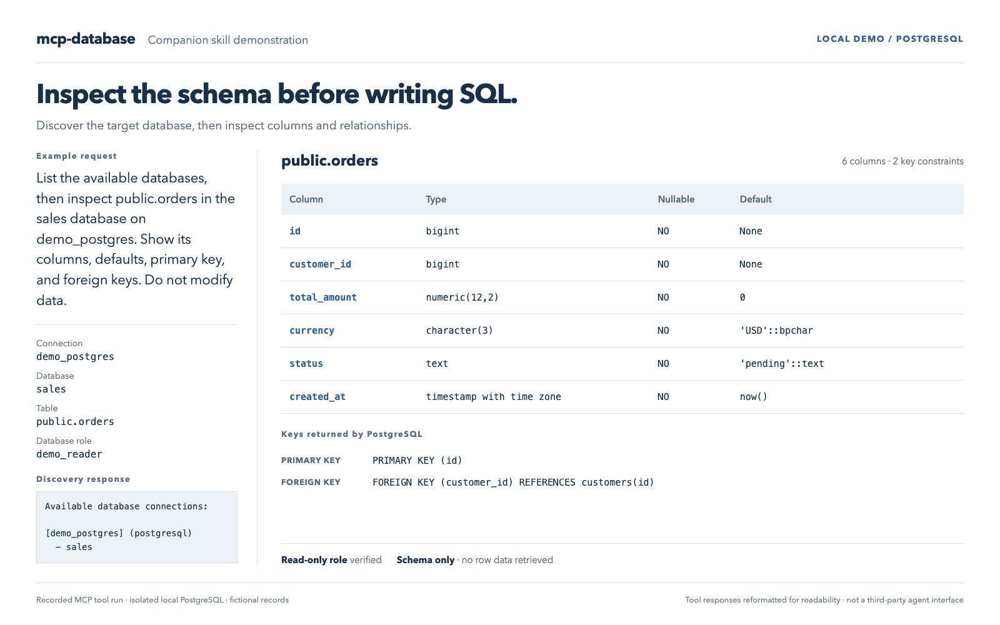
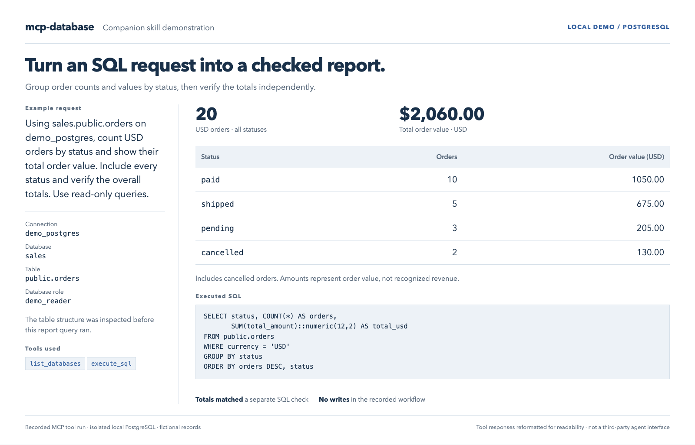

# MCP Database Companion Skill

The companion skill teaches an AI agent how to use the **mcp-database server** for database discovery, schema inspection, SQL reports, and authorized data corrections. The skill supplies instructions; the server supplies the database tools.

The skill package is distributed separately, including through supported marketplaces. It is **not included in this repository**. This page documents how to use it with the server.

## What it helps with

- Explore MySQL and PostgreSQL tables, columns, keys, and relationships.
- Produce SQL summaries and reports with explicit connection and database targets.
- Preview authorized data corrections and verify affected rows and resulting data.
- Investigate uncertain query outcomes instead of blindly replaying submitted SQL.

These instructions help reduce mistakes; they do not guarantee correct SQL or replace database privileges.

## Before you begin

You need:

- An agent that can load the skill instructions and call the configured server's MCP tools.
- A local checkout of this server and npm. Use Node.js 22+ for development and tests; the declared server runtime minimum is Node.js 18.
- Your own MySQL or PostgreSQL database access.
- SSH access only when your database connection uses a tunnel.

Specific agent integrations have not all been tested. Marketplace access requirements and client configuration vary.

Follow the server's [installation](../README.md#installation), [configuration](../README.md#configuration), and [client setup](../README.md#usage) instructions. The package name is `db-access`, but the server is intended for local builds; do not assume that `npx db-access` installs this project from npm.

Keep database credentials and SSH keys in your local environment. Do not upload them to a marketplace or paste them into chat.

## Load the skill and verify access

1. Build and configure the server, then register its local stdio entry point with your MCP client.
2. Load the separately obtained skill through your agent or marketplace's supported mechanism. Skill delivery does not install the server.
3. Ask the agent to call `list_databases` and identify the intended connection and database.
4. Check that target with `SELECT 1 AS connection_ok` through `execute_sql`, supplying `connection`, `database`, and `sql`.

A listed database is not proof of connectivity. A successful connectivity check is not proof of correct permissions or recovery behavior.

Before data changes, verify that the configured server build enforces single-statement calls and does not automatically replay SQL after submission. This implementation uses `assertSingleStatement` in both adapters and `QueryOutcomeUnknownError` for transient failures after submission. Rebuild and restart the server after updating it. Older builds may behave differently; a package version alone does not establish compatibility.

## Example: inspect a schema

Example request:

```text
List the available databases, then inspect public.orders in the sales
database on demo_postgres. Show its columns, defaults, primary key,
and foreign keys. Do not modify data.
```



The recorded run discovered `demo_postgres` and `sales`, checked access separately, then inspected six columns and two key constraints using metadata queries.

## Example: generate an order report

Example request:

```text
Using sales.public.orders on demo_postgres, count USD orders by status
and show their total order value. Include every status and verify the
overall totals. Use read-only queries.
```



The report grouped 20 fictional USD orders by status. A separate SQL check verified the total order value of USD 2,060.00. Cancelled orders are included, so this is order value, not recognized revenue.

### Demo evidence

These are formatted reports of actual MCP responses, not captures of a third-party agent interface or an end-to-end marketplace installation. A scripted MCP SDK client called the locally built server against an isolated PostgreSQL 18.3 instance. The database contained six fictional customers and twenty fictional orders.

The recorded workflow used a SELECT-only database role with read-only transactions enabled. The local database was stopped afterward.

- [Original calls and responses](assets/mcp-database/mcp-demo-transcript.json)
- [Fictional database fixture](assets/mcp-database/demo-fixture.sql)
- [Matching request and result text](assets/mcp-database/demo-form-text.txt)
- [Standalone HTML presentation](assets/mcp-database/demo.html) — download and open locally

The demo validates this PostgreSQL read path. It does not establish live MySQL or SSH integration, failure recovery under real network outages, or compatibility with every agent.

## Permissions

Normal operation calls `list_databases` and `execute_sql` on the configured MCP server. That server connects to the configured databases and optionally through SSH tunnels.

Read access is needed for bundled references and any local files inspected during user-requested setup. Terminal and file-write access are needed only when the user asks the agent to install dependencies, build the server, or create local configuration. The scope is the user-selected checkout and configuration files.

Data modifications require user authorization and sufficient database privileges. Use a database-enforced read-only account for analysis-only access. Keyword blocking does not enforce read-only access.

## Known limitations

- Each SQL tool call accepts exactly one statement.
- Calls borrow pooled connections with no guaranteed session affinity. Do not split transactions across calls or rely on temporary tables, session variables, or locks surviving between them.
- Stored routines with multiple result sets are not supported. An unsupported-result error can occur after execution; do not repeat the call just to obtain output.
- Displayed results may be truncated; use SQL filters, limits, and aggregates as appropriate.
- A connection failure after submission can leave the outcome unknown. Reconcile database state before considering another attempt.
- The skill cannot provide database access, configure credentials automatically, or make an older server follow the current execution contract.

## Frequently asked questions

### Does the skill replace the MCP server?

No. The server executes database tools; the skill guides the agent's workflow. Both must be available to the agent.

### Can I use it with both MySQL and PostgreSQL?

Yes, through the corresponding configured server connection. The schema queries differ by dialect. The recorded examples on this page use PostgreSQL.

### Does it make all database changes safe?

No. It calls for explicit targets, authorization, previews, bounded changes, and verification. Correctness still depends on the request, schema, privileges, running server build, and the agent's actions.

### Where is the skill package?

It is supplied separately through the creator's distribution channel. This repository contains the server, this guide, and demo assets, not the distributable skill files.

## License

The server and this documentation use the repository's [MIT license](../LICENSE). The companion skill is separately distributed under MIT with the required notice included in its package. MIT permits commercial sale, use, modification, and redistribution subject to its terms. Marketplace delivery and account terms also apply when using a marketplace.
